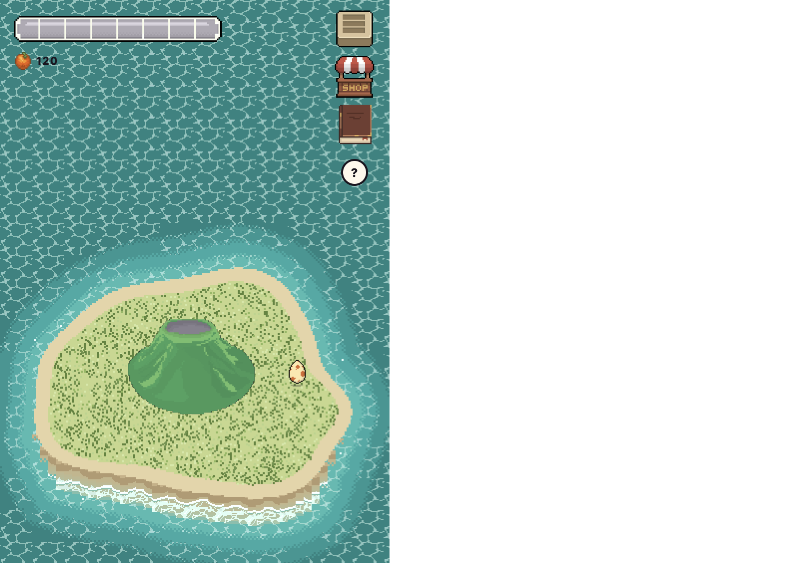
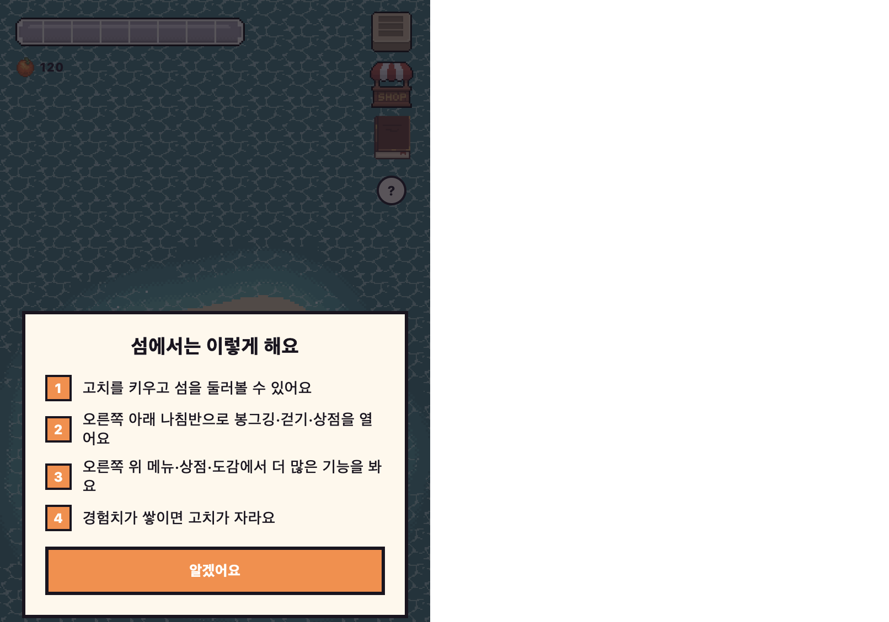
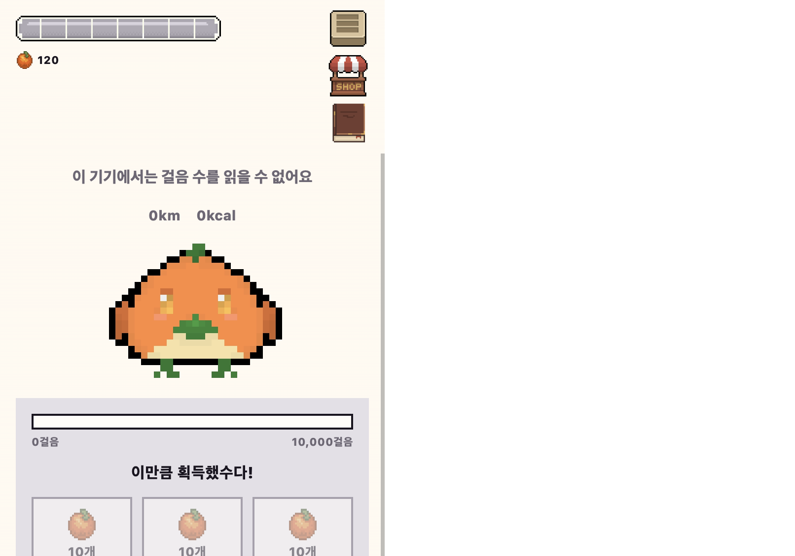
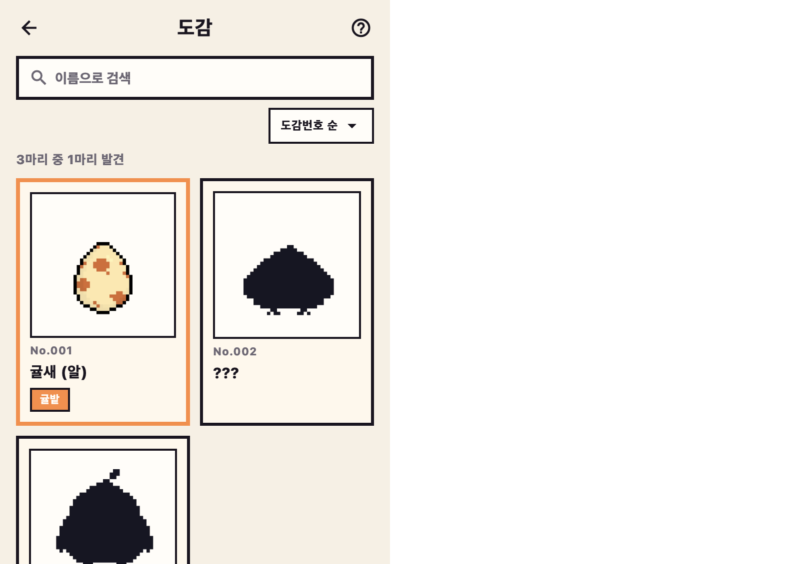
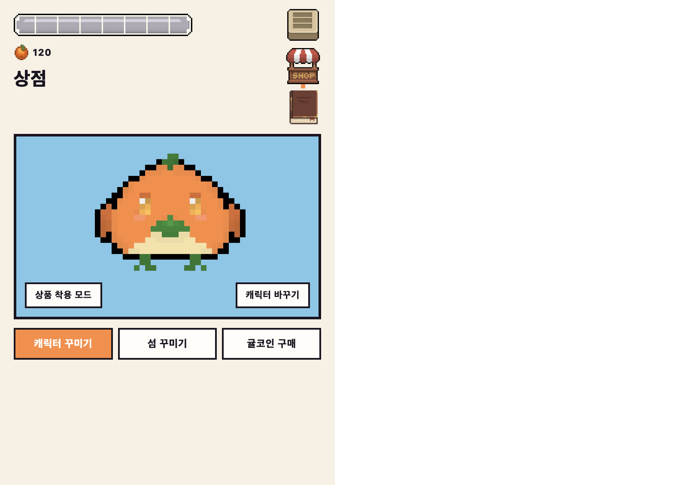
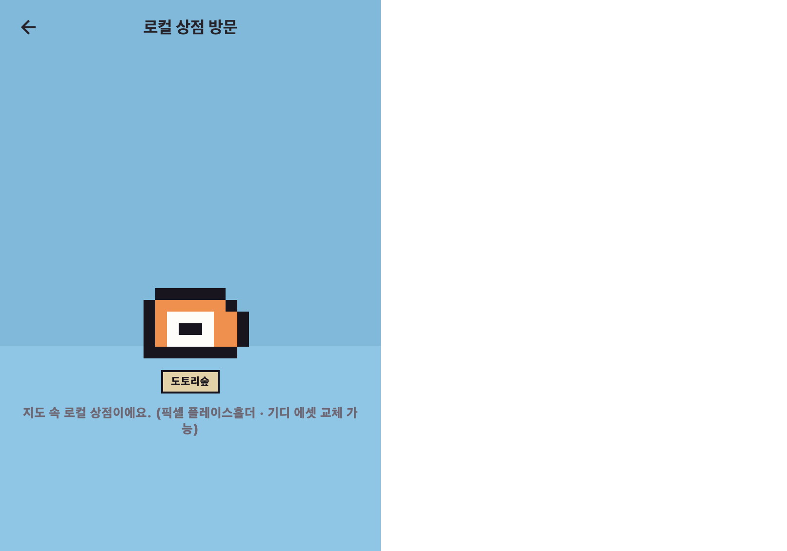

# 가치고치 (Gachi Gochi)

걸음과 쓰레기 줍기(봉그깅)로 **고치**를 키우는 픽셀 감성 모바일 앱입니다.  
섬에서 고치를 돌보고, 걷기로 귤·경험치를 모으며, 봉그깅으로 인증하고, 상점·도감에서 성장의 흔적을 확인합니다.

Expo SDK 58 · Expo Router · 픽셀 UI

---

## 앱 한눈에 보기

### 1. 섬 홈

고치가 사는 섬입니다. 경험치 바·귤 잔액, 메뉴·상점·도감·도움말이 오른쪽에 있고, 오른쪽 아래 나침반으로 걷기·봉그깅·로컬 상점을 엽니다.



### 2. 홈 도움말

`?` 를 누르면 섬에서 할 일을 바로 다시 볼 수 있습니다.



### 3. 걷기

오늘 걸음으로 단계별 귤·XP를 받습니다. 아이폰은 HealthKit, 안드로이드는 Health Connect로 오늘 누적 걸음을 읽습니다. (웹·미지원 기기에서는 안내 문구가 뜹니다.)



### 4. 봉그깅

카메라로 쓰레기를 찍어 인증하는 화면입니다. 인증하면 경험치가 쌓이고 고치가 자랍니다.


### 5. 도감

발견한 고치·생물을 모아 보는 화면입니다. 검색·정렬로 찾고, 아직 못 본 친구는 실루엣으로 남습니다.



### 6. 상점

귤로 캐릭터·섬을 꾸미거나 상품을 고릅니다.



### 7. 로컬 상점

지도 속 로컬 상점을 방문하는 화면입니다. (플레이스홀더 UI · 에셋 교체 예정)



---

## 주요 흐름

1. **온보딩**으로 이름을 짓고 섬에 들어갑니다.  
2. **활동 튜토리얼**로 나침반 → 봉그깅 → 걷기를 한 바퀴 돕니다.  
3. 평소에는 섬에서 고치를 키우고, 걷기·봉그깅으로 보상을 모읍니다.  
4. 메뉴에서 온보딩·활동 안내를 다시 볼 수 있고, 화면의 `?`로 기능 도움말을 엽니다.

---

## 요구 사항

- Node.js 22.23.3 (`.nvmrc`). 이 맥에는 `n`이 있으므로 `sudo n 22.23.3`으로 맞춥니다.
- npm만 사용합니다. `package-lock.json`을 커밋하고 yarn/pnpm lock은 만들지 않습니다.
- HealthKit / Health Connect·카메라는 **Expo Go가 아니라 development build**가 필요합니다.

Git 줄바꿈은 레포의 `.gitattributes`가 LF로 맞춥니다. 각자 컴퓨터에서 한 번만 아래를 실행합니다.

```bash
git config --global core.autocrlf false
```

## 실행

```bash
npm install
npm start
```

QR이 다른 IP로 잡히면 `npx expo start --tunnel`로 엽니다. 윈도우에서 흔합니다.

네이티브 기능(건강·카메라) 확인:

```bash
npx expo run:ios
# 또는
npx expo run:android
```

라이브러리는 `npx expo install <패키지>`로 추가합니다. 합치기 전에는 `npm run doctor`를 실행합니다.

## 환경 변수

`.env.example`을 `.env`로 복사해 값을 채웁니다. 앱에 들어갈 값은 `EXPO_PUBLIC_`로 시작합니다. `.env`는 커밋하지 않습니다.

## 배포

스토어에 올리는 파일은 EAS Build가 클라우드에서 만듭니다. 맥이 없어도 iOS 빌드가 됩니다. `ios`/`android` 폴더는 커밋하지 않습니다.

`app.json`의 번들 ID는 `com.gachigochi.app`입니다. 스토어에 올린 뒤에는 바꾸지 않습니다.

`eas.json` 프로필:

- `development`: development build (`expo-dev-client`)
- `preview`: 스토어 심사 없이 폰에 설치. Android는 APK
- `production`: App Store / Play 스토어 제출용

### 계정

- [Expo](https://expo.dev) 계정
- Apple Developer Program (연 $99) — iOS 실기기·스토어
- Google Play Console (등록비 $25) — Play 스토어

### 폰에 깔아서 확인

```bash
npx eas-cli login
npx eas-cli init
npx eas-cli build --platform android --profile preview
npx eas-cli build --platform ios --profile preview
```

### App Store / Play 스토어

```bash
npx eas-cli build --platform all --profile production
npx eas-cli submit --platform ios --profile production
npx eas-cli submit --platform android --profile production
```

## 개발 기록

### 2026-09-28

- 저장소를 처음 만들었습니다.

### 2026-10-01

- Expo로 앱을 열었습니다. 앱 이름은 Gachi Gochi, 번들 ID는 `com.gachigochi.app`입니다.
- 맥과 윈도우에서 같이 작업하도록 Node 22.23.3, npm, LF 줄바꿈, `.gitignore`를 맞췄습니다.

### 2026-10-03

- 피그마 와이어프레임을 기준으로 기초 화면을 만들었습니다.
- 앱은 섬 홈에서 시작합니다.

### 2026-11

- 온보딩·강제 튜토리얼·기능별 `?` 도움말을 붙였습니다.
- 걷기는 HealthKit(iOS) / Health Connect(Android)로 오늘 걸음을 읽도록 연결했습니다.
- Expo SDK 58 기준으로 맞췄습니다.
